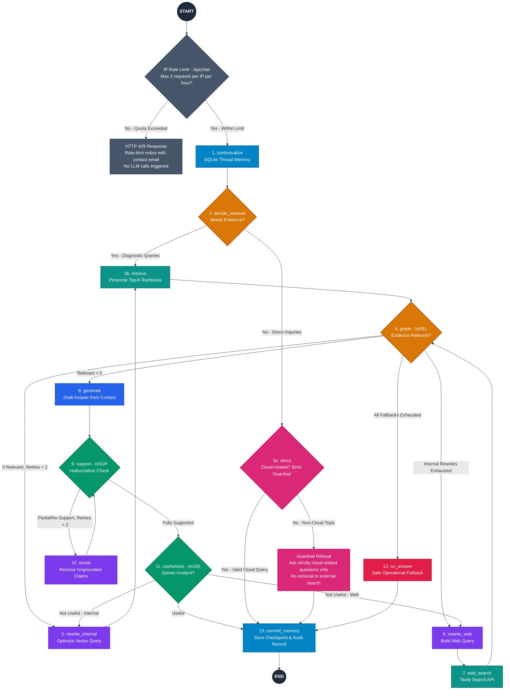

<div align="center">

# 🛡️ CloudOpsLLM — Self-RAG Incident Response Copilot

<p align="center">
  
  
  
  
  
  
  
  
  
</p>

**Ground every production troubleshooting decision in private operational runbooks, or verified real-time internet context when internal docs fall short.**

</div>

---

## 🔒 Source Code Access Notice

> **Note:** The core proprietary production implementation, adaptive Self-RAG routing nodes, and custom operational chunking workflows are maintained inside an authenticated private repository.  
> If you are a recruiter, collaborator, or engineering team looking to audit the full codebase or evaluate architecture integration, please contact: **[shubham.shivare9112@gmail.com](mailto:shubham.shivare9112@gmail.com)**.


## 🏗️ Architecture & Self-RAG Graph



**Graph Color Legend:**  
🟦 **Blue (`Memory & Generation`)** · 🟩 **Teal (`Pinecone / Tavily Retrieval`)** · 🟧 **Amber (`LLM Grading & Routing`)** · 🟪 **Purple (`Self-Correction & Query Rewrite`)** · 🟢 **Emerald (`IsSUP & IsUSE Verification`)** · 🟥 **Crimson (`Safe No-Answer Fallback`)** · ⬛ **Slate (`IP Rate Limiter`)** · 🩷 **Pink (`Cloud-Only Guardrail & Refusal`)**

---
---

## ✨ Core Highlights

- 🧠 **13-Node LangGraph Self-RAG**: Dynamically routes incident queries, grades evidence relevance (`IsREL`), automatically rewrites sub-optimal queries, verifies context support/hallucinations (`IsSUP`), and validates operational usefulness (`IsUSE`).
- 📚 **Private Runbooks First**: Prioritizes internal SOP documents (`.pdf`, `.md`, `.txt`, `.docx`) utilizing deterministic SHA-256 chunking (`_stable_chunk_id`) to ensure repeated ingestions never produce duplicate vector entries.
- 🌐 **Smart Web Fallback**: Triggers targeted **Tavily** web search only after internal operational runbook query rewrites have been exhausted without sufficient relevance score.
- 🚧 **Cloud-Only Guardrail**: Non-retrieval conversational questions route through a strict cloud classifier. Queries unrelated to cloud, DevOps, or site-reliability engineering are halted with a safe, direct guardrail refusal without invoking downstream tools.
- ⏱️ **IP Rate Limiting**: Enforces a sliding-window rate limit (default: 2 requests per IP per hour) on `/api/chat` with `X-Forwarded-For` proxy awareness to safeguard LLM tokens and downstream APIs.
- 💾 **Stateful Checkpointing & Audit Trails**: Preserves continuous thread state across multi-turn diagnostic sessions using SQLite checkpointing (`langgraph_memory.sqlite`) and logs every routing step and query trace to an audit store (`audit.db`).

---
---

## 🔌 API Endpoints Reference

| Method | Endpoint | Description |
| :--- | :--- | :--- |
| `POST` | `/api/chat` | Runs the full 13-node Self-RAG graph (`{"question": "...", "thread_id": "..."}`) and returns response, active route, `IsSUP` score, `IsUSE` assessment, and workflow trace. Rate-limited to 2 requests/IP/hr. |
| `POST` | `/api/upload` | Uploads and indexes new operational runbooks (`.pdf`, `.md`, `.txt`, `.docx`) into Pinecone with deduplication hashes. |
| `GET` | `/api/audits` | Retrieves chronological audit event records from SQLite (`?limit=20`). |
| `GET` | `/api/health` | Health and connectivity check across database and LLM inference providers. |

---

## 🔍 Observability & Auditing

1. **Integrated UI Trace Drawer & SQLite Audit**:
   - Each state transition is captured within `state["trace"]`, exposed in the console's **"Inspect Self-RAG workflow trace"** panel, and permanently logged to `data/audit.db`.
2. **Native LangSmith Telemetry**:
   - Built on `langchain-core>=0.3.0` and `langgraph>=0.2.0`, configuring the following environment variables enables automatic end-to-end tracing:
     ```env
     LANGCHAIN_TRACING_V2=true
     LANGCHAIN_ENDPOINT=https://api.smith.langchain.com
     LANGCHAIN_API_KEY=lsv2_pt_your_langsmith_key
     LANGCHAIN_PROJECT=CloudOpsLLM
     ```

---

## 📬 Contact & Inquiries

For technical audits, integrations, or access requests:
- **Email:** [shubham.shivare9112@gmail.com](mailto:shubham.shivare9112@gmail.com)
- **GitHub:** [@Shubh9966](https://github.com/Shubh9966)
